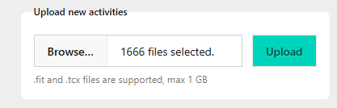

# Activities: self-hosted sport training journal

Activities is a self-hosted application to archive sport activities, manage a training journal and
track training context:

- Import sport activities from `.tcx` and `.fit` files,
- Keep a training journal with notes on workouts and training blocks,
- Track training context like weight, nutrition and subjective feedback,
- Explore and check your progress with custom training metrics,
- It can be deployed from a single Docker image,

## Quick start: try it locally

To quickly test the application visit https://demo.activities.training/ or try it locally with
Docker by running the following command and visiting http://localhost:8080:

```bash
docker run --rm -p 8080:80 \
  -e ACTIVITIES_DATA_PATH=/app/data \
  -e ACTIVITIES_ALLOW_REGISTRATION=true \
  -v activities_data:/app/data \
  ghcr.io/thomas-god/activities:latest
```

## Deploying using _docker-compose_ or _docker-stack_

The most basic `docker-compose.yaml` file looks like that:

```yaml
services:
  activities:
    image: ghcr.io/thomas-god/activities:latest
    environment:
      ACTIVITIES_DATA_PATH: /app/data
      ACTIVITIES_ALLOW_REGISTRATION: "true"
    volumes:
      - activities_data:/app/data

volumes:
  activities_data:
```

The application will store all its data at the location pointed by `ACTIVITIES_DATA_PATH`, so use a
docker volume to persist your data between restarts and to facilitate backups. The application can
also [back up its databases automatically](#database-backups) on a schedule.

### HTTPS is recommended, plain HTTP is still possible on a trusted network

The bundled image only serves plain HTTP and does not terminate TLS by itself. Session cookies are
marked `Secure` only when the request reaches the backend over HTTPS — as reported through the
`X-Forwarded-Proto` header by a TLS-terminating reverse proxy (e.g.
[Caddy](https://caddyserver.com/) or [Traefik](https://traefik.io/)). Over plain HTTP the cookie is
still set, so login works, but it then travels in clear. Only use HTTP when the traffic is already
protected by another layer, for example a [WireGuard](https://www.wireguard.com/) or
[Tailscale](https://tailscale.com/) tunnel.

A minimal `docker-compose.yaml` with Traefik handling TLS looks like:

```yaml
services:
  activities:
    image: ghcr.io/thomas-god/activities:latest
    environment:
      ACTIVITIES_DATA_PATH: /app/data
      ACTIVITIES_ALLOW_REGISTRATION: "true"
    volumes:
      - activities_data:/app/data
    labels:
      - "traefik.enable=true"
      - "traefik.http.routers.activities.rule=Host(`your.domain`)"
      - "traefik.http.routers.activities.entrypoints=websecure"
      - "traefik.http.routers.activities.tls.certresolver=letsencrypt"
      - "traefik.http.services.activities.loadbalancer.server.port=80"

  traefik:
    image: traefik:v3.2
    command:
      - "--providers.docker=true"
      - "--providers.docker.exposedbydefault=false"
      - "--entrypoints.web.address=:80"
      - "--entrypoints.websecure.address=:443"
      - "--certificatesresolvers.letsencrypt.acme.httpchallenge=true"
      - "--certificatesresolvers.letsencrypt.acme.httpchallenge.entrypoint=web"
      - "--certificatesresolvers.letsencrypt.acme.email=you@your.domain"
      - "--certificatesresolvers.letsencrypt.acme.storage=/letsencrypt/acme.json"
    ports:
      - "80:80"
      - "443:443"
    volumes:
      - /var/run/docker.sock:/var/run/docker.sock:ro
      - traefik_letsencrypt:/letsencrypt

volumes:
  activities_data:
  traefik_letsencrypt:
```

### Email-based authentication

By default user authentication uses an email address with password, but it does not require an
external SMTP server to function. Without it email addresses are not verified and users won't
received any email from the application. You can configure an optional SMTP server to enable email
verification and password-less authentication, see the [configuration below](#configuration).

> At startup, a warning reports how many existing users have no password registered (if your
> instance pre-dates the authentication update). Those accounts can only log in through the
> email-based flow so make sure they set a password from their account settings while email login is
> still enabled, otherwise disabling email-based authentication will lock them out. An
> [admin](#admin-role) can also set a password for those accounts.

### Configuration

The application accepts the following environment variables. Each environment variable supports a
`*_FILE` variant to load the variable content from a file
[instead](https://docs.docker.com/engine/swarm/secrets/#build-support-for-docker-secrets-into-your-images).

| Variable name                       | Required             | Purpose                                                                                                                                                                            | Example                 |
| ----------------------------------- | -------------------- | ---------------------------------------------------------------------------------------------------------------------------------------------------------------------------------- | ----------------------- |
| ACTIVITIES_DATA_PATH                | yes                  | Location to store application data (raw activity files and databases content).                                                                                                     | /app/data               |
| ACTIVITIES_ALLOW_REGISTRATION       | yes                  | Wether new users can register an account. Set to `false` to only allow already-registered users to log in.                                                                         | false                   |
| ACTIVITIES_MAILER_FROM              | for email-based auth |                                                                                                                                                                                    | no-reply@your.domain    |
| ACTIVITIES_MAILER_USERNAME          | for email-based auth | SMTP username                                                                                                                                                                      |                         |
| ACTIVITIES_MAILER_PASSWORD          | for email-based auth | SMTP password                                                                                                                                                                      |                         |
| ACTIVITIES_MAILER_RELAY             | for email-based auth | SMTP server                                                                                                                                                                        |                         |
| ACTIVITIES_MAILER_DOMAIN            | for email-based auth | The domain on which your instance is hosted. Used to craft the auth link url. Can be a different domain than the one used by your SMTP server.                                     | https://app.your.domain |
| ACTIVITIES_BOOTSTRAP_ADMIN_EMAIL    | no                   | Email of the account to create or promote as the first admin at startup. Must be set together with the password variable; the bootstrap only runs while the instance has no admin. | admin@your.domain       |
| ACTIVITIES_BOOTSTRAP_ADMIN_PASSWORD | no                   | Password for the bootstrapped admin account. Set together with the email variable. A `*_FILE` variant is recommended to keep the secret out of the deployment configuration.       |                         |

#### Database backups

The application can automatically back up its SQLite databases on a schedule. Prefer using this
feature rather than just doing direct backups of the database files, as this might not preserve
SQLite internal invariant and result in corrupted or inconsistent backups.

Backups are opt-in: set `ACTIVITIES_DB_BACKUP_CRON` to enable them.

Each run writes a single `backup-<timestamp>.zip` archive to `ACTIVITIES_DB_BACKUP_PATH` (which
defaults to `<ACTIVITIES_DATA_PATH>/backups`). The archive contains the databases plus a
`manifest.json` with the timestamp, the application and SQLite versions, and each database's size.

Raw activity files (`activities/`) are not part of these archives: they are regular binary files
that can be backed up with any file copy tool.

> Backups are written inside the data volume by default. This protects against database corruption
> but **not** against the loss of that volume: point `ACTIVITIES_DB_BACKUP_PATH` at a separate mount
> and/or replicate the archives elsewhere (e.g. with `restic` or `rsync`) to survive disk or host
> failure.

To restore a backup: stop the application, replace the files in `<ACTIVITIES_DATA_PATH>/db/` with
the databases extracted from the archive, then start it again. Restoring an older `user.db` may
invalidate sessions created after the backup.

| Variable name                  | Required | Purpose                                                                                 | Example     |
| ------------------------------ | -------- | --------------------------------------------------------------------------------------- | ----------- |
| ACTIVITIES_DB_BACKUP_CRON      | no       | Cron expression enabling automatic backups (5, 6 or 7 fields). Unset disables them.     | `0 3 * * *` |
| ACTIVITIES_DB_BACKUP_PATH      | no       | Directory where the archives are written. Defaults to `<ACTIVITIES_DATA_PATH>/backups`. | /backups    |
| ACTIVITIES_DB_BACKUP_RETENTION | no       | Number of most recent archives to keep (`0` keeps all of them). Defaults to `7`.        | 14          |

Backups can also be triggered manually with `app backup run`, which is useful before an upgrade or
from an existing host scheduler:

```bash
# Backup all the databases once (the archive path and duration are printed).
docker exec -it <container> /app_bin backup run
```

#### Admin role

An **admin** is a regular account flagged as administrator that has extra rights to manage users
(create new one, reset email address and password, etc.). The first admin is configured either:

- **from the environment** — set both `ACTIVITIES_BOOTSTRAP_ADMIN_EMAIL` and
  `ACTIVITIES_BOOTSTRAP_ADMIN_PASSWORD` (or `ACTIVITIES_BOOTSTRAP_ADMIN_PASSWORD_FILE`) before
  starting the container. The account is created if it does not exist, and promoted otherwise (with
  its password updated). Once an admin exists the variables become inert, so remove them from your
  configuration afterwards (cannot be used to additional admin users).
- **with the CLI** — `app admin ...` runs directly against the database, without a session and
  without the rest of the server configuration. It is also the break-glass path when the server
  cannot start or the current admin is locked out:

  ```bash
  # Create an user as admin. Prefer --password-file to keep the secret out of the process list.
  docker exec -it <container> /app_bin admin bootstrap \
    --email admin@your.domain --password-file /run/secrets/admin

  # Promote an existing user to admin. No-op if the user is already an admin.
  docker exec -it <container> /app_bin admin promote --email admin@your.domain

  # Bootstrapping can be used to reset the password of an existing admin user.
   docker exec -it <container> /app_bin admin bootstrap \
     --email existing_admin@your.domain --password-file /run/secrets/new_admin_pwd

  # Clear the admin flag (fails if it would leave the instance with no admin).
  docker exec -it <container> /app_bin admin revoke --email admin@your.domain
  ```

#### Observability

`OTEL_EXPORTER_OTLP_ENDPOINT` and `OTEL_SERVICE_NAME` go through the application's own config loader
like the variables above, so the `*_FILE` variant described above works for them too (e.g.
`OTEL_EXPORTER_OTLP_ENDPOINT_FILE`). They keep the standard OpenTelemetry names (rather than an
`ACTIVITIES_` prefix) for interoperability with collectors/dashboards that expect them. `RUST_LOG`
is read directly by the `tracing` ecosystem instead, since it's a generic `tracing`/`log` convention
rather than something specific to this app (the `*_FILE` variant does not apply to it).

| Variable name               | Required | Purpose                                                                                                                                                                              | Example                    |
| --------------------------- | -------- | ------------------------------------------------------------------------------------------------------------------------------------------------------------------------------------ | -------------------------- |
| OTEL_EXPORTER_OTLP_ENDPOINT | no       | OTLP/HTTP (protobuf) collector base endpoint — `/v1/traces` is appended automatically. When unset, tracing spans are only logged to stdout and no OpenTelemetry exporter is started. | http://otel-collector:4318 |
| OTEL_SERVICE_NAME           | no       | `service.name` resource attribute reported on exported spans. Defaults to `activities-app`.                                                                                          | activities-app             |
| RUST_LOG                    | no       | Log/span level filter ([`EnvFilter` syntax](https://docs.rs/tracing-subscriber/latest/tracing_subscriber/filter/struct.EnvFilter.html)). Defaults to `info`.                         | app=debug,tower_http=info  |

## Migrating from a deprecated single-user instance

Previous versions of _activities_ had a _single-user_ mode to connect either without any
authentication or we a single root password. These modes have been deprecated since the _multi-user_
mode can now be deployed without external dependencies (it required a valid SMTP before).

To migrate your existing instance:

- Backup your data as for any migration.
- Make sure your instance runs in _multi-user_ mode by checking its startup logs. You can force it
  by changing your configuration to use `ACTIVITIES_ALLOW_REGISTRATION` (`true` or `false`).
- Make your existing single-user multi-user compatible:
  - First create a temporary [admin user](#admin-role).
  - Connected as the admin user you can see your existing user in the `/settings` page, it should
    have a `default_user` ID, an invalid email address and no password set.
  - Set you email address and password (and you can set it as admin), and check that you can connect
    as it.

## Upload your training history

Most device manufacturers and training platforms allow you to download your activities history:

- _Coros_: Training Hub > Activity List > Export Data
- _Garmin Connect_: Account Settings > Account Information > Export all of your Garmin data
- _Strava_: Settings > My Account > Download or Delete Your Account

They will usually send you a link by email to download an archive containing all your data.
Depending on the archive format you should find an activities folder containing `.fit` and or `.tcx`
files, often compressed in `.gz`.

Then simply upload those files (including compressed ones) using the upload form. It can take a few
minutes depending of your history size but then you are good to go!



## Intended scope and limitations

- The application focuses on providing athletes with tools to track and analyze their training:
  organizing activities into training periods, keeping training notes, defining custom metrics, and
  visualizing performance trends. While social features like friends, timeline, or sharing are not
  planned, coaching-related features might be considered in the future.
- Because the application is designed to be self-hosted, and since sport device ecosystems are
  mostly closed, there is sadly no feature to automatically import your activities from your
  devices.

## Design decisions

Key design decisions are documented [here](adr/README.md).

## Credits

Favicon from [OpenMoji](https://openmoji.org/) – the open-source emoji and icon project. License:
[CC BY-SA 4.0](https://creativecommons.org/licenses/by-sa/4.0/)
